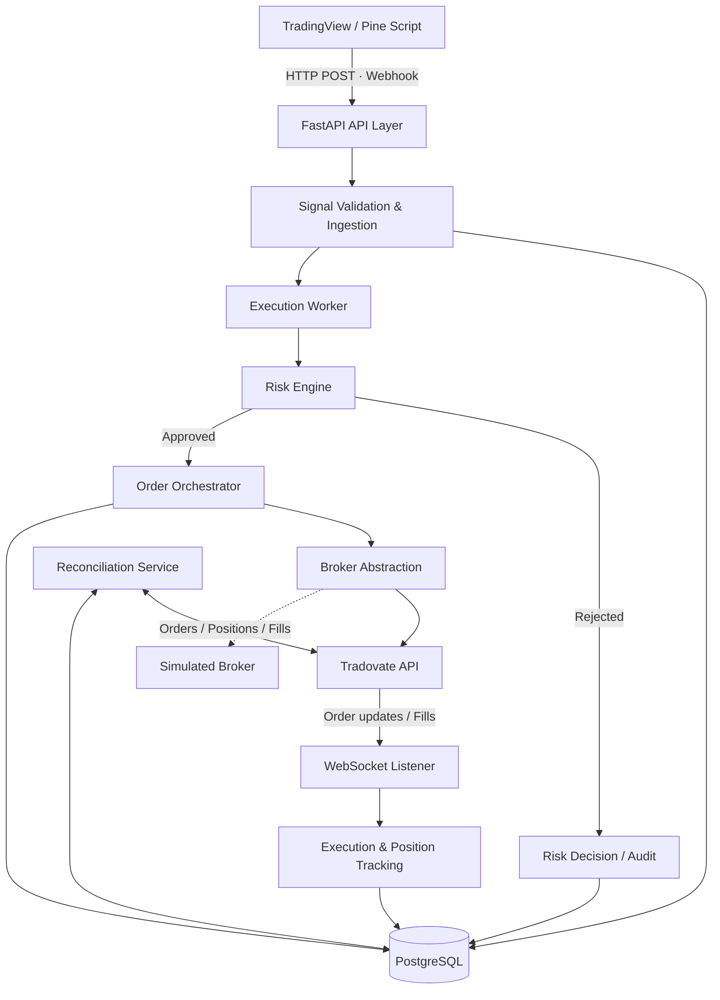

# Trading Execution & Risk Management Service

A Python-based trading execution backend that connects TradingView strategy alerts to Tradovate, automating order execution while enforcing independent risk controls and maintaining consistent trading state.

The system is designed around **reliability, fault tolerance and execution safety**, prioritising correctness and recoverability over unnecessary infrastructure complexity.

---

## Overview

This project aims to automate the execution workflow between TradingView and Tradovate through a centralised backend service.

TradingView generates signals from a Pine Script trading strategy. Rather than submitting orders directly, signals are sent to the execution service, which validates each request, evaluates independent risk constraints and coordinates order submission through the broker API.

Beyond order execution, the service maintains a persistent record of signals, risk decisions, orders and executions, allowing it to recover and reconcile its internal state against the broker following application restarts or connectivity failures.

### Core objectives

- **Automated execution:** Process TradingView alerts and submit approved orders through Tradovate.
- **Independent risk management:** Enforce configurable risk constraints before orders reach the broker.
- **Execution reliability:** Handle duplicate signals, network failures, partial fills and ambiguous order submissions safely.
- **State consistency:** Maintain persistent trading records and reconcile them against broker-side account state.
- **Operational control:** Provide an emergency kill switch, structured logging and system health monitoring.

## System Architecture

The application follows a **modular monolithic architecture**, separating business responsibilities into distinct components while maintaining a single deployable backend.

This approach provides clear module boundaries without introducing the operational overhead of distributed services.

### High-level architecture

### Execution flow

1. **Signal generation:** TradingView evaluates the Pine Script strategy and generates an entry, exit or other supported trading signal.
2. **Signal ingestion:** FastAPI receives the webhook, authenticates the request and validates its payload.
3. **Persistence:** The signal is recorded in PostgreSQL, with duplicate detection enforced through database constraints.
4. **Risk evaluation:** The execution worker evaluates the signal against independent risk rules and current account state.
5. **Order orchestration:** Approved signals are translated into broker-compatible orders and submitted through the broker abstraction.
6. **Execution tracking:** Broker responses and WebSocket events update order states and record individual fills.
7. **Reconciliation:** The service periodically and on startup compares its internal records against broker-side orders, executions and positions.

The webhook endpoint acknowledges requests promptly after durable ingestion. Broker execution takes place asynchronously, avoiding long-running operations within TradingView's webhook request window.

---

## Technology Stack

| Component | Technology | Responsibility |
|---|---|---|
| Language | Python 3.12+ | Application and execution logic |
| API framework | FastAPI | HTTP endpoints and webhook ingestion |
| Validation | Pydantic | Request schemas and configuration validation |
| ORM | SQLAlchemy 2.0 | Database models and persistence |
| Database | PostgreSQL | Durable application and trading state |
| Migrations | Alembic | Database schema evolution |
| Broker integration | Tradovate API | Order submission and account synchronisation |
| Async processing | Python asyncio | Asynchronous I/O and background processing |
| Testing | Pytest / HTTPX | Unit, integration and API testing |
| Code quality | Ruff | Linting and formatting |
| Containerisation | Docker / Docker Compose | Reproducible development and deployment |
| CI/CD |

**Infrastructure philosophy:** Start with a single application and PostgreSQL instance. Avoid introducing additional infrastructure such as Redis, Kafka or Kubernetes until a demonstrable requirement justifies it.

---

## Application Architecture

The codebase is organised around business responsibilities rather than technical layers alone.

| Module | Responsibility |
|---|---|
| `api/` | HTTP endpoints, webhook handling and API routing |
| `signals/` | Signal schemas, validation and ingestion |
| `risk/` | Independent risk rules and approval decisions |
| `execution/` | Order orchestration and lifecycle management |
| `brokers/` | Broker abstraction and broker-specific implementations |
| `reconciliation/` | Synchronisation of internal and broker-side state |
| `database/` | SQLAlchemy models, sessions and persistence |
| `core/` | Application configuration, logging and shared utilities |

### Component boundaries

**Strategy — TradingView**

Pine Script remains responsible for strategy-specific logic and signal generation. The execution service does not attempt to reproduce the trading strategy.

**Execution service — Python**

The backend is responsible for interpreting signals, validating requests, enforcing independent risk constraints and managing the order lifecycle.

**Broker — Tradovate**

Tradovate is the authoritative source for actual orders, executions, account balances and positions.

**Database — PostgreSQL**

PostgreSQL maintains the application's durable record of incoming signals, risk decisions, order intent, broker references, executions and reconciliation history.

---

## Engineering Principles & Design Decisions

Reliability is a primary design consideration. The system is designed to handle failures explicitly rather than assuming that API requests, network connections or broker responses always succeed.

### 1. Idempotent signal processing

TradingView webhook delivery and network retries can result in duplicate requests.

Each incoming signal is assigned a unique identity, with database-level uniqueness constraints preventing the same signal from being processed into multiple orders.

### 2. Explicit order state management

Order execution is modelled as a state machine rather than a collection of loosely coupled status updates.

This makes permitted state transitions explicit and allows the application to handle asynchronous broker updates, partial fills, cancellations and uncertain submission outcomes.

### 3. Fail-safe risk enforcement

Every order must pass independent pre-trade risk checks before submission.

If critical information such as account state, position exposure or risk configuration cannot be established, the service blocks new executions rather than proceeding with incomplete information.

### 4. Durable state and transaction management

PostgreSQL is used as the persistent source of application records.

Order intent, risk decisions and execution updates are persisted with appropriate transaction boundaries, foreign keys and uniqueness constraints.

Financial quantities and prices use decimal representations rather than binary floating-point arithmetic.

### 5. Broker abstraction

Broker-specific implementation details are isolated behind a common interface.

This allows the execution workflow to be tested against a simulated broker before integrating with Tradovate, while keeping broker-specific API logic separate from core business logic.

### 6. Reconciliation and recovery

The service cannot assume its local state is always synchronised with the broker.

Following application restarts or connectivity failures, it retrieves broker-side orders, executions and positions and reconciles them against its persistent records before allowing new executions.

### 7. Observability and operational control

Structured logging, correlation identifiers, health checks and execution history provide visibility into system behaviour.

An emergency kill switch provides an explicit mechanism to prevent new order submissions.

---

## Risk Management

The risk engine provides an independent safety layer between signal ingestion and order submission.

Initial configurable controls include:

- Maximum order quantity.
- Maximum position exposure.
- Daily loss limit.
- Maximum trades per day.
- Supported instrument allowlist.
- Trading-hours restrictions.
- Duplicate signal detection.
- Account synchronisation requirements.
- Global trading enablement / emergency kill switch.

Risk decisions are persisted with their outcomes and rejection reasons to provide an auditable record of why an order was or was not permitted.

---

## Reliability & Failure Handling

The system explicitly considers failure scenarios that can result in unintended or inconsistent trading activity.

| Failure scenario | Design approach |
|---|---|
| Duplicate webhook | Database-enforced idempotency |
| Concurrent signals | Transactional risk checks and database locking |
| Broker API timeout | Mark submission outcome as uncertain and reconcile before retrying |
| Partial execution | Track individual fills against the parent order |
| WebSocket disconnection | Reconnect and resynchronise broker state |
| Expired authentication | Token renewal and controlled reauthentication |
| Application restart | Recover outstanding orders through reconciliation |
| Database failure | Block new executions until persistence is restored |
| Broker state disagreement | Reconcile before resuming execution |

**Important:** A network timeout does not necessarily mean an order was rejected. The broker may have accepted the order even if the application never received its response. The service must establish the actual broker-side outcome before attempting another submission.

---

### Testing strategy

Automated tests will cover both normal execution and failure scenarios:

- Signal validation and authentication.
- Duplicate webhook delivery.
- Risk rule enforcement.
- Concurrent signal processing.
- Order state transitions.
- Partial fills and cancellations.
- Broker API timeouts and failures.
- Database transaction behaviour.
- Application restart and reconciliation.
- End-to-end signal-to-execution workflows.

---

## Deployment

Initial development and testing will take place locally using Docker Compose.

The intended deployment architecture uses a single Linux VPS running the application, background execution worker and PostgreSQL database.

TradingView communicates with the service through a publicly accessible HTTPS webhook endpoint. Broker communication uses Tradovate's REST and WebSocket APIs.

Deployment will prioritise:

- Secure credential management.
- HTTPS and authenticated webhook requests.
- Persistent database storage.
- Automated database backups.
- Application restart policies.
- Health checks and structured logs.
- Recovery and reconciliation after failures.

Distributed infrastructure and additional services will only be introduced if future requirements justify their operational complexity.

---

## Scope & Limitations

The initial implementation targets:

- A single-user trading environment.
- Futures instruments, initially MNQ and ES.
- TradingView as the signal source.
- Tradovate as the initial broker.
- Market-order execution.
- Low-frequency automated trading.
- Demo and simulated execution environments.

Strategy research, high-frequency execution, multi-broker routing and a full graphical dashboard are outside the initial scope.

---